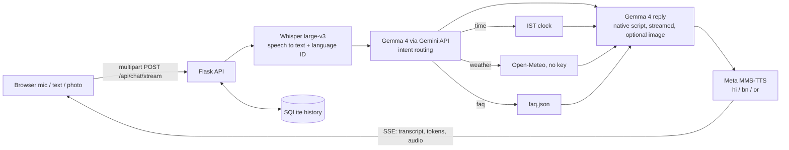

# Bolo (बोलो · বলো · କୁହ): a multilingual voice assistant

> Speak in **Hindi** or **Bengali**, hear the answer spoken back in the same language. Type in **Odia** and hear it spoken in Odia. Show it a photo and ask about it.

**🔴 Live demo: `<<PASTE LIVE URL HERE>>`**  ·  Repo license: [MIT](LICENSE)  ·  Built by **Team J** at Hack4Haldia'26 (3 hours)

Every AI step in the core pipeline runs on an **open-weight model**:

| Step | Model | Parameters | License / terms | Where it runs |
|---|---|---|---|---|
| Speech to text | [Whisper large-v3](https://huggingface.co/openai/whisper-large-v3) (OpenAI) | 1.55 B | MIT | Hosted by [Groq](https://console.groq.com/docs/model/whisper-large-v3) (default) or locally via [faster-whisper](https://github.com/SYSTRAN/faster-whisper) |
| Understanding, translation, intent routing, replies, **image understanding** | **Gemma 4** (`gemma-4-26b-a4b-it`, auto-fallback `gemma-4-31b-it`) from Google | 26 B (4 B active) / 31 B | [Gemma terms](https://ai.google.dev/gemma/terms) · [model docs](https://ai.google.dev/gemma) | **Through the Gemini API** (`google-genai` SDK) |
| Text to speech | [Meta MMS-TTS](https://huggingface.co/facebook/mms-tts-hin) `hin` / [`ben`](https://huggingface.co/facebook/mms-tts-ben) / [`ory`](https://huggingface.co/facebook/mms-tts-ory) | ~36 M each | CC-BY-NC 4.0 (non-commercial; see each model card) | Runs inside our server (PyTorch, CPU) |

Fallbacks, not in the main path: Google Translate TTS (gTTS) if MMS fails (Hindi/Bengali/English only).

## What it does

1. You tap the mic and speak (or type, or attach a photo).
2. **Whisper** transcribes and detects the language.
3. **Gemma 4** classifies the intent (time / weather / FAQ / chat), calls a tool if needed, and writes a short spoken-style reply **in your language**. With a photo attached, Gemma 4 looks at the image too.
4. **MMS-TTS** turns the reply into speech. Text streams to the screen while the voice is generated.



## Language support (honest matrix)

| Language | Speak to it | Type to it | It speaks back |
|---|---|---|---|
| Hindi (hi) | ✅ Whisper | ✅ | ✅ MMS-TTS |
| Bengali (bn) | ✅ Whisper | ✅ | ✅ MMS-TTS |
| Odia (or) | ❌ Whisper has no Odia model, so the app says so in Odia and asks you to type | ✅ | ✅ MMS-TTS |
| English (en) | ✅ | ✅ | ✅ (gTTS) |

## How we use Gemma 4 through the Gemini API

All in [`services/llm.py`](services/llm.py), one `google-genai` client:

| Use | Function | Notes |
|---|---|---|
| Translation (`/api/translate`) | `translate()` | any of hi/bn/or/en |
| Intent routing | `route_intent()` | strict-JSON classification: `time`, `weather` (+ city), `faq`, `chat` |
| Spoken replies in the user's language | `reply()` / `reply_stream()` | streaming via `generate_content_stream` |
| **Multimodal: photo + question** | `reply(..., image=)` | image resized + sent as an image part; ask in Hindi/Bengali/Odia |
| Model resilience | `_generate()` | tries `GEMMA_MODEL`, then falls back to the other Gemma 4 size; `/health` lists the Gemma 4 ids the API reports |

## Feature checklist (organizer's list)

**Must-have**
- [x] Record audio and transcribe with an open-weight speech model (Whisper)
- [x] Respond in the same language (Gemma 4)
- [x] Play the reply with text to speech (MMS-TTS)
- [x] Hindi + Bengali (+ Odia output)

**Bonus**
- [x] Intent routing: time, weather (Open-Meteo), FAQ
- [x] Streaming responses (Server-Sent Events)
- [x] Language auto-detect (Whisper language ID + Unicode script check)
- [x] Offline fallback (service worker + localized offline messages + browser speech)

**"Industry-level" items:** audio upload handling (size cap, magic-byte validation, clean errors), SQLite conversation history, per-IP rate limiting, model fallbacks, Docker deployment, automated tests.

## Run locally

```bash
python -m venv .venv && source .venv/bin/activate       # Windows: .venv\Scripts\activate
pip install -r requirements.txt                          # add: -r requirements-local-stt.txt for keyless local Whisper
cp .env.example .env                                     # then put in GEMINI_API_KEY (and GROQ_API_KEY)
python app.py                                            # http://localhost:5000
```

No keys yet? `python tests/dev_mock_server.py` runs the whole UI with stand-in models (port 5055).
The first request per voice downloads ~140 MB of MMS weights from Hugging Face.

With Docker: `docker build -t bolo . && docker run -p 8080:8080 --env-file .env bolo`

## API

| Method | Path | Body | Returns |
|---|---|---|---|
| GET | `/health` | n/a | status, models in use, which keys are configured |
| GET | `/api/languages` | n/a | supported languages |
| POST | `/api/transcribe` | multipart `audio` (+ `language`) | `{text, language, backend, duration_ms}` |
| POST | `/api/translate` | `{text, target, source?}` | `{text, source, target}` |
| POST | `/api/speak` | `{text, lang}` | audio (`audio/wav`) |
| POST | `/api/chat` | multipart: `audio` or `text`, `image?`, `lang?`, `session_id?` | `{transcript, language, intent, reply_text, audio_b64, timings}` |
| POST | `/api/chat/stream` | same | Server-Sent Events: `status`, `transcript`, `intent`, `token`…, `reply`, `audio`, `done` |
| GET | `/api/history?session_id=` | n/a | recent turns from SQLite |

Errors are always `{error, code, user_message}`, where `user_message` is in the user's language.

## Tests

```bash
pip install -r requirements-dev.txt && pytest -q        # 20 offline tests (models stubbed)
python tests/roundtrip.py https://<live-url>            # REAL models: MMS speaks -> Whisper listens -> checks language + text
```

## Deploy

Docker image, single gunicorn worker (models are shared in memory), ≥ 2 GB RAM. See [DEPLOY.md](DEPLOY.md) (DigitalOcean App Platform, DigitalOcean Droplet + HTTPS, or Hugging Face Spaces).

## Known limitations

- Whisper has no Odia, so Odia is typed-in / spoken-out only.
- MMS voices are intelligible but flat, and are licensed non-commercially.
- Free-tier API quotas (Gemini, Groq) can rate-limit a busy demo; the app then says so in the user's language.
- SQLite lives on the container disk; history resets on redeploy.

## Team

`<<Name 1>>`, `<<Name 2>>`, `<<Name 3>>`, `<<Name 4>>`

MIT licensed. Models retain their own licenses (table above).
